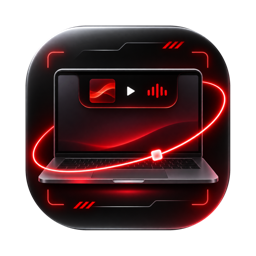

  
  <h1>NetNotch</h1>
  
<strong>Музыка, файлы и системные индикаторы в чёлке MacBook</strong>

  
<a href="https://github.com/andruha2618/NetNotch/releases/download/v1.0.1/NetNotch-1.0.1-macOS.zip"><strong>Скачать NetNotch 1.0.1</strong></a> · <a href="https://github.com/andruha2618/NetNotch/releases">Все выпуски</a>

  
macOS 13 и новее · Apple Silicon и Intel

Нажми на чёлку, чтобы посмотреть, что играет, переключить трек или перемотать песню. Перетащи файл к верхнему краю, чтобы сохранить его на полке и забрать позже. Всё это доступно поверх текущего приложения.

## Что умеет NetNotch

- **Плеер Spotify и Apple Music.** Обложка, прогресс, перемотка и управление треками. Четыре компоновки — «Классика», «Капсула», «Постер» и «Винил».
- **Файловая полка и AirDrop.** Собери до десяти файлов перетаскиванием и отправь их через AirDrop прямо из панели.
- **История буфера.** Найди недавно скопированный текст, ссылку или изображение. История хранится локально и отключается в настройках.
- **Громкость, яркость и зарядка.** Управляй видом индикаторов в чёлке. Подключение AirPods показывается штатным уведомлением macOS.

## Установка

1. Распакуй [NetNotch-1.0.1-macOS.zip](https://github.com/andruha2618/NetNotch/releases/download/v1.0.1/NetNotch-1.0.1-macOS.zip) и перенеси **NetNotch.app** в «Программы».
2. Запусти приложение. Настройки открываются через значок NetNotch в строке меню.
3. Для управления Spotify или Apple Music macOS может запросить разрешение на автоматизацию. Для переноса индикаторов громкости и яркости в чёлку может потребоваться «Универсальный доступ».

Этот выпуск подписан ad-hoc и не нотарифицирован Apple. macOS может показать предупреждение при первом запуске.

[Сообщить об ошибке](https://github.com/andruha2618/NetNotch/issues/new) · [NetRunner](https://github.com/andruha2618/NetRunner) · [NetDeck](https://github.com/andruha2618/NetDeck)
